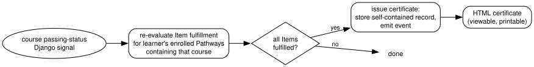

.. _openedx-learning-adr-0008:

8. Pathway Credentials
======================

Status
------

Draft

Context
-------

Learners who complete a Pathway should receive a certificate, in the same way as the built-in Open edX course
certificates. Individual courses inside a Pathway keep their existing course certificates unchanged; this decision is
only about the Pathway-level credential.

Decisions
---------

1. **Earning rule.** A learner earns the Pathway certificate by fulfilling all Items in the Pathway. In the MVP that
   means passing every course in the Pathway, where "passing" is dictated by each course's own grading policy. There
   are no Pathway-level grades, thresholds, or enrollment modes.

2. **Automatic issuance via signals.** The Pathways app listens for the Django signals the platform already emits when
   a learner's course passing status changes. On each relevant signal, it re-evaluates the learner's Item fulfillment
   for any enrolled Pathways containing that course, and issues the certificate as soon as all Items are fulfilled.
   No manual issuing step is required.

3. **Configuration in Django admin.** Pathway certificates are configured in the Django admin, not in Studio. A
   certificate configuration can be created, previewed, edited, and deleted while inactive; it must be activated
   before certificates are issued. Configuration includes the issuing organization and 1–4 signatories (name, title,
   organization, signature image).

4. **Rendering.** An issued certificate is rendered by the LMS as an HTML page (printable by the learner), analogous
   to course certificates. No W3C Verifiable Credentials / Open Badges support in Willow.

   The LMS certificates code is built on legacy frontend code and is expected to be rewritten in the near future. To
   avoid adding to the effort of that rewrite, the Pathway certificate addition to the LMS is kept as lightweight as
   possible: a simple issued-certificate record, similar to ``GeneratedCertificate``, and a minimal rendering
   view, which can later be migrated to whatever replaces the current implementation. The Credentials IDA is not
   used, as integrating with it would be a much larger project.

5. **What a certificate is a claim about.** A certificate ties a learner to a specific version of the Pathway
   content: the versioned side of the split described in :ref:`openedx-learning-adr-0007`, because a certificate
   asserts that a particular Pathway completion definition was met. The Catalog Pathway is not recorded separately.
   Instead, it follows from the content version.

6. **Issued certificates are records.** Alongside that reference, a certificate stores a snapshot of the values shown
   on it: recipient name, Pathway name, issuer, the criteria met (the list of courses passed), and the date earned.
   The certificate is rendered from this snapshot rather than from live data, so it looks the same even if the learner
   later changes their name or the Pathway is renamed, updated, or archived. The snapshot only freezes what is
   displayed; what the certificate asserts (which Pathway completion definition the learner met) is defined by the
   version reference from the previous point.

   Signatories are not part of the snapshot. As with course certificates, they are read from the current certificate
   configuration when the certificate is rendered. Preserving them per certificate would require versioning
   certificate configurations, which is out of scope for the MVP.

7. **Events.** Issuing a certificate emits an event, so that instances can report on credentials (e.g. in Aspects).
   It also sends an email to the learner, with a link to view the certificate.

8. **Independence from course certificates.** Pathway certificates are earned from course grades (via the grades
   API), not from course certificates, so courses in a Pathway don't need to award certificates. Pathway and course
   certificates do not interact: revoking a course certificate does not affect a Pathway certificate.

9. **Manual revocation.** Staff can manually revoke an issued Pathway certificate. A revoked certificate is no longer
   viewable by the learner. The details of revocation mechanism will be defined later.

.. Run `dot -Tsvg images/pathway-credentials.dot > images/pathway-credentials.svg` to regenerate the diagram after
   making changes to `images/pathway-credentials.dot`.

Consequences
------------

- Because issuance uses the existing platform signals, no polling or batch jobs are needed for the typical flow.
- Since certificates are self-contained records, later edits to the Pathway never alter what a learner already earned
  or what their certificate shows. The only exception is signatories, which follow the current certificate
  configuration.
- Interaction-progress-based criteria, per-course credential rules, badges/microcredentials, and verifiable
  credentials are all explicitly out of scope and can be layered on later without changing the basics of this design.
